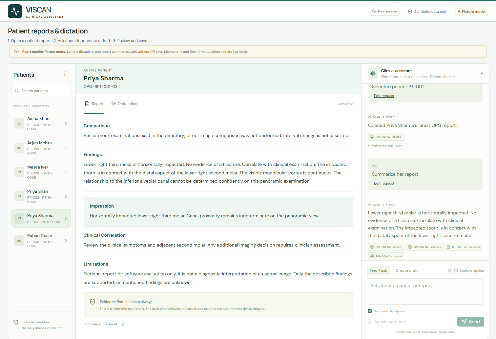

# VI-SCAN clinical assistant

A voice-first dental assistant proof of concept using **synthetic patients and reports only**. Find reports, ask source-backed questions, and turn dictated observations into editable drafts. No diagnostic image analysis is performed.



## Run locally

Requires Python 3.12 and Node.js 22. No GPU is required.

```sh
python -m venv .venv
```

Activate the environment: Windows PowerShell `.\.venv\Scripts\Activate.ps1`; macOS/Linux `source .venv/bin/activate`.

```sh
python -m pip install -r requirements-lock.txt
cd frontend
npm ci
npm run build
cd ..
python -m backend.bootstrap
python -m uvicorn backend.app.main:app --host 127.0.0.1 --port 8000
```

Open http://127.0.0.1:8000. API reference: http://127.0.0.1:8000/docs. SQLite is created locally at `data/viscan.db`; bootstrap applies migrations and seeds six fictional patients and 18 reports. Use one backend worker.

The default **fixture mode** supports limited sample retrieval, summaries and dictation without API keys. For **live mode**, copy `.env.example` to `.env`, set `AI_MODE=live`, `GOOGLE_API_KEY` and `GROQ_API_KEY`, then restart. Keep credentials server-side. On Windows, `./start.ps1 -Mode live` is available after installing dependencies.

## What works

- Voice/text report retrieval with modality/date filtering, ambiguous-name clarification, confirmation-only approximate matches and conversational corrections.
- Session-aware single/all-report summaries and report questions with original source excerpts, report IDs and versions. Missing information and partial failures are explicit.
- Clinical dictation into editable findings and JSON, retaining source evidence, negation, uncertainty and corrections. Explicit versioned saving keeps every result a draft requiring clinician review.
- Streaming transcription, automatic pause submission, manual stop/cancel, automatic spoken responses and playback interruption. Cloud speech failures can use a disclosed browser voice fallback.
- Conversation, selected report and saved drafts survive refresh in the owned demo session.

Try: **Open Priya's latest OPG report** → **It's actually Priya Sharma** → **Summarize her report**. Inspect a citation and tool trace. Select **Create draft**, dictate an observation, review and save. **Open Meera Iyer's latest OPG report** demonstrates the missing-modality case.

## Architecture and tool calling

[One-page architecture](docs/architecture-one-page.pdf) · [Detailed design and workflows](docs/system-design.md) · [UI testing guide](docs/UI-TESTING-GUIDE.md) · [Provider experiment results](verification/model-selection.md)

React/TypeScript/Vite serves the workspace; FastAPI/Pydantic handles commands; SQLite/SQLAlchemy/Alembic stores synthetic reports, sessions and draft revisions. A small custom Python orchestrator is sufficient for these bounded workflows.

- **Retrieval:** voice → STT (typed text bypasses STT) → HTTP command → LLM plan → Python identity/ambiguity validation → latest-report query → report and source.
- **Dictation:** transcript → structured LLM extraction → Python evidence/anatomy/negation/uncertainty checks → editable draft JSON → clinician review → versioned save.
- **Follow-up:** question → session patient/report context → LLM evidence selection → quote/version validation → answer with source, followed by optional speech.

Groq receives a real typed function, `plan_assistant_action`, to propose intent/name/modality. Python validates its arguments and independently executes allowlisted operations. Trace entries such as `search_patients` and `get_latest_report` show those deterministic backend operations; they are not separate model-exposed tools. The LLM cannot run SQL or save a report directly. Clinical extraction uses structured output followed by separate Python business validation.

Configured providers: Google streaming STT (`gemini-3.5-transcribe-live`), Groq LLM (`openai/gpt-oss-120b`), Groq file STT fallback (`whisper-large-v3`), Groq TTS (`canopylabs/orpheus-v1-english`, Troy) and Google TTS fallback (`gemini-3.8-flash-lite-tts`). Account access, model terms and quotas apply; configuration is not a guarantee of current availability.

## Verification

Latest recorded local unit/API result: **283 passed**, using isolated SQLite databases and mocked providers; [JUnit evidence](verification/tests.xml). Historical real-provider experiments are distinct from these automated tests and do not guarantee current quota or human speech accuracy.

```sh
python -m pytest -q
```

With the local server running in fixture mode, `python -m scripts.demo_api` exercises the documented API sequence. [Recorded API evidence](verification/api-demo.json) is included. The [UI guide](docs/UI-TESTING-GUIDE.md) describes manual checks; the final video link will be added after recording.

## Limitations and production considerations

- Local synthetic-data POC: no production clinic login, PACS/DICOM ingestion, imaging diagnosis, clinical signing or deployment. Cookie ownership is demo authorization. SQLite and process-local locks assume one instance.
- Voice is turn-based with a 20-second capture limit, not continuous full-duplex conversation. Human microphone/accent/noise evaluation remains limited. Speech quotas may require the visibly disclosed browser fallback.
- Provenance and bounded language checks reduce unsupported claims but do not prove complete clinical correctness. Source-supported uncertainty must remain, and clinician review is mandatory.
- Keys stay server-side; audio buffers are transient, while transcripts/history/drafts persist locally. Real deployment needs clinic authorization, retention/deletion controls, encryption and vendor privacy review.
- Inputs and context/draft versions are validated. Provider requests have timeouts, bounded retries and quota cooldowns. Responses remain visible if speech fails. Latency and costs depend on inference, audio length and collection size; no unlimited free tier is assumed.

## Submission note

**Works:** report retrieval and identity clarification, grounded follow-ups, structured dictation/review/save, session recovery and voice integration, with 283 passing recorded local tests.

**Incomplete:** the final demo recording is pending. Broader real-device voice/clinical evaluation, production authentication and multi-instance operation are not implemented.

**With more time:** expand spoken/adversarial evaluations, measure end-to-end latency and name-recovery accuracy, improve endpointing and evidence rules, and add production identity, retention and monitoring controls.

Repository contents are limited to application source/tests, synthetic seeds, setup files, essential design/testing documentation, and selected verification evidence. Credentials, local databases, dependencies, development notes and generated archives are excluded.
