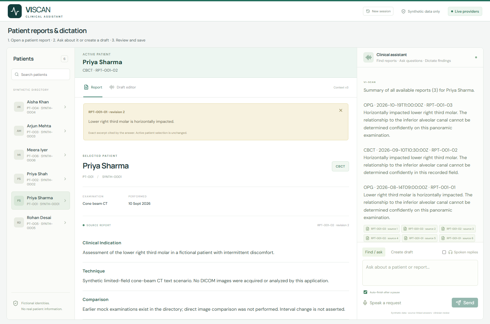

# VI-SCAN clinical assistant

A voice-first dental proof of concept with safe patient/report retrieval, evidence-backed follow-ups, and editable structured dictation drafts. **Synthetic data only. No diagnostic imaging inference.**



Recorded browser evidence; later Build-badge and conversation fixes are described in the current status.

## What works

- Six fictional patients, including Priya Sharma/Priya Shah, with 18 synthetic reports.
- Name disambiguation, confirmation-only approximate suggestions, natural clarification and zero-match correction recovery; modality filtering and deterministic latest-report selection.
- Session-aware single/all-report summaries and live report questions with report/version/source excerpts. Collection scope has per-report dates/citations, explicit partial failures and an unchanged active report. Unique named follow-ups use the selected patient; ambiguous/different names require clarification. Answers use a short selection of exact supporting excerpts with controlled terminology explanations; the evidence panel retains the original wording. Compound summary/cause questions keep their original text and explicitly state when a cause is not established.
- Google live STT with visible partial transcripts, automatic submission after a pause, and manual stop/cancel controls. Groq Whisper Large v3 transcribes a buffered utterance if streaming fails.
- Groq function calling for intent interpretation; Python validates identity, arguments, context and service-operation scope. Eligible indirect identity replies use separate structured interpretation; supported pure acknowledgements stay local, while thanks plus a task preserves the whole request.
- Structured dictation with source spans, negation, uncertainty and correction handling; editable findings, versioned saves, and JSON export. Every save remains a draft requiring clinician review.
- Groq Orpheus English speech, Google TTS and disclosed browser-voice fallbacks, on-by-default spoken replies and explicit playback stop. Long collection answers use a labeled spoken overview.
- Explicit fixture mode without keys or a GPU. Unknown fixtures return a clear unsupported-fixture result.

## Quick start: Docker

Requires Docker with Compose. From this project directory:

```sh
cp .env.example .env
docker compose up --build
```

Open http://localhost:8000. Default mode is `fixture`; no keys are needed. The Docker image build and a temporary-container smoke test passed (startup, migrations, seeding, retrieval and audio-worklet asset). The native installation below was also verified. The actual Compose configuration was also started with a named volume; report selection and history survived container recreation.

## Native installation (verified path)

Requires Python 3.12 and Node.js 22 with npm. Commands below start in the repository root.

```sh
python -m venv .venv
```

Activate the virtual environment: Windows PowerShell `.\.venv\Scripts\Activate.ps1`; macOS/Linux `source .venv/bin/activate`.

```sh
python -m pip install -r requirements-lock.txt
cd frontend
npm ci
npm run build
cd ..
python -m backend.bootstrap
python -m uvicorn backend.app.main:app --host 127.0.0.1 --port 8000
```

Open http://127.0.0.1:8000. API documentation: http://127.0.0.1:8000/docs. SQLite persists under `data/viscan.db`. Bootstrap applies Alembic migrations and inserts missing seeds. It upgrades only exact archived revision-1 fixtures to revision 2, preserving unrelated/custom edits.

Windows convenience launcher after installation: `./start.ps1 -Mode fixture` or `./start.ps1 -Mode live`.

For frontend development, run `npm run dev` inside `frontend/` in a second terminal. Vite proxies HTTP/WebSocket requests to port 8000. Use one hostname consistently; switching between localhost and 127.0.0.1 creates separate cookie sessions.

## Live mode and environment variables

Copy `.env.example` to `.env` if it does not exist. Set `AI_MODE=live`, `GOOGLE_API_KEY`, and `GROQ_API_KEY`, then restart the server. Existing exported environment variables override `.env`. Never put keys in React variables or commit `.env`.

Default model settings:

- LLM: `openai/gpt-oss-120b` through Groq.
- Streaming STT: `gemini-3.5-transcribe-live` through Google.
- File STT fallback: `whisper-large-v3` through Groq.
- English TTS: `canopylabs/orpheus-v1-english`, voice `troy`, through Groq.
- TTS fallback: `gemini-3.8-flash-lite-tts` through Google.
- `DATABASE_URL`, `ALLOWED_ORIGINS`, and `COOKIE_SECURE` configure storage and browser boundaries. Set secure cookies when using HTTPS.

Provider access and free quotas depend on the account and may change. Orpheus requires model-terms acceptance by the account administrator. A successful request does not establish zero billing. Keep inputs synthetic, particularly on vendor free tiers with different retention/data-use terms.

## Full UI test guide

Follow [UI-TESTING-GUIDE.md](docs/UI-TESTING-GUIDE.md) for exact end-to-end inputs, expected screens, JSON/voice/recovery checks and negative tests. The [requirement checklist](docs/REQUIREMENTS-CHECKLIST.md) maps assignment requirements to code and recorded evidence.

## Try the demo

1. Ask **Open Priya's latest OPG report**; select one of the two Priyas.
2. Ask **Summarize her report**; inspect source links and tool steps.
3. Open **Draft editor** and select a sample with uncertainty; inspect findings and JSON.
4. Edit a finding without adding unsupported claims, then **Save reviewed draft**. It remains a draft.
5. Ask **Open Meera Iyer's latest OPG report** to demonstrate the missing-modality path.

Live mode adds microphone transcription, arbitrary dictated observations, report-aware questions, and TTS. Press **Speak a request**, wait for capture to be ready, speak a short request, then pause for automatic submission or use **Stop & submit**. Listening is limited to 20 seconds. Speech generation does not delay the visible answer. Start another voice turn or use Stop speech to cancel playback.

## Automated checks and evidence

Latest recorded isolated unit/API result: **283 passed** in `verification/tests.xml`. The production frontend build passed. Older native/Docker/Compose/live-provider checks are historical executions, not fresh health or quota guarantees after every source change. See [current implementation status](docs/implementation-status.md) and [connected workflow audit](docs/WORKFLOW-AUDIT.md).

```sh
python -m pytest -q
python -m scripts.demo_api
```

The first command uses isolated SQLite fixtures and no external APIs. The second requires the local server in fixture mode and records the documented seven-step API sequence.

Browser smoke (server in fixture mode):

```sh
cd frontend
npx playwright install chromium
cd ..
node scripts/browser_smoke.cjs
```

Alternatively set `CHROME_PATH` to an installed Chrome executable. Local verification used installed Chrome. Opt-in synthetic live tests, which call providers:

```sh
python -m scripts.live_smoke
python -m scripts.live_voice_smoke
```

Recorded evidence lives under `verification/`: browser screenshots, API demo outputs, live application smoke, live voice events, model comparisons, and generated audio. See [demo evidence](docs/demo.md) and [implementation status](docs/implementation-status.md).

## Architecture and decisions

Start with the [documentation index](docs/README.md), [system design](docs/system-design.md), [one-page architecture](docs/architecture-one-page.pdf), [visual diagrams](docs/README.md), and [provider experiments](verification/model-selection.md).

The architecture PDF includes these numbered execution paths:

- **Retrieval:** 1 voice through STT (typed input bypasses STT) → 2 HTTP command → 3 LLM retrieve plan → 4 Python identity/ambiguity validation → 5 latest-report query → 6 report plus source.
- **Dictation:** 1 final transcript → 2 LLM extraction → 3 `validate_findings` checks quoted evidence, anatomy, negation and uncertainty → 4 editable draft JSON → 5 clinician review → 6 versioned draft save.
- **Follow-up:** 1 question → 2 selected patient/report context → 3 LLM evidence selection → 4 source/quote/version checks → 5 answer plus source excerpt, followed by optional speech.

The STT, LLM and TTS links pass through their provider adapters; SQLAlchemy handles database access separately. Model outputs remain proposals until Python validation passes. Local acknowledgement/exact-clarification paths can skip inference.

The application is one FastAPI process with a static React build, SQLite/SQLAlchemy/Alembic, and a small typed Python orchestrator. No agent framework or vector database is required. Session state and idempotency are persisted; per-session processing locks are process-local. Run one worker. PostgreSQL and a distributed turn/lock strategy would be needed before scaling to multiple replicas; that migration has not been tested.

## Tool calling and business-rule separation

In live mode, Groq receives a real function schema named `plan_assistant_action` and an explicit `tool_choice`. For “Open Aisha Khan’s latest OPG report”, it proposes `action=retrieve`, `patient_name=Aisha Khan`, `modality=OPG`. Python validates the returned function/arguments, then performs patient lookup, ambiguity/confirmation checks and the latest-report database query. The LLM cannot choose a patient ID, run SQL, bypass session ownership or save a report by itself. Fixture mode replaces interpretation with a labeled deterministic router and uses the same service rules.

The model-facing function is the planner. Trace entries such as `search_patients` and `get_latest_report` describe deterministic service operations actually executed; they are not separate functions exposed to the model. This is function calling followed by deterministic integration, rather than an autonomous multi-tool agent loop.

Clinical extraction is a separate structured-output LLM call. Python checks quoted evidence, negation, uncertainty, patient context and draft version before accepting edits/saves. These checks are conservative provenance rules, not proof of complete clinical correctness.

The voice WebSocket transcribes only; the browser submits the final utterance as a separate HTTP command. The service has explicit dispatch, not an autonomous tool loop.

In live mode, **Spoken replies** is on by default: directory selection, typed commands, voice commands and identity confirmations automatically speak their response. **Listen** replays a response (the cloud input is limited to 600 characters); **Listen to overview** explicitly replays the short overview for long collection summaries. Uncheck **Spoken replies** to mute automatic replies for all input paths. Press the microphone again to answer a confirmation; continuous listening during playback is not implemented. Long all-report summaries have a labeled short spoken overview; their full per-report findings remain on screen. If both cloud speech providers fail, an available browser voice reads the same reply or disclosed overview with a visible browser-voice label. If no browser voice is available, text remains with a visible retry error. Stop and mute apply to every playback path.

## Limits and production considerations

- This is a synthetic-data assessment application. Cookie-based session ownership is demonstration authorization, **not production authentication** or a compliance certification.
- No real PACS, DICOM ingestion, image diagnosis, booking, clinical signing or production deployment.
- Microphone flow supports an energy-based automatic pause detector and manual stop. It is not an always-listening full-duplex agent. Audio capture and playback interruption are implemented, but echo/noise/accent behavior needs testing on real microphones. Live voice verification used synthetic PCM through the actual WebSocket path and a Chrome fake microphone; generated speech also decoded in Chrome.
- Draft source/evidence checks reduce unsupported content but do not prove semantic entailment. Human review is mandatory. Deterministic anatomy-conflict rules are deliberately conservative and not a complete dental language parser.
- Fixture dictation supports the displayed samples only; report questions require live mode. No silent live-to-fixture fallback.
- The visible Build badge, `/api/config` build_id and X-App-Build response header identify startup source/frontend code. Restart after backend changes; reload after frontend changes. APIs use no-store, the page/worklet revalidate, and no service worker is used. New command IDs execute new turns; stored history is not regenerated after a fix.
- Browser reload restores selected report context, persisted conversation, pending patient choices and session drafts. Short clarification replies such as “It’s Priya Shah” complete the pending request. Up to six recent turns are supplied as reference context, restricted to the active patient/report/revision; clinical evidence must still come from the report. Local form edits recover when their version still matches the server version. New session clears the active workspace without deleting prior stored sessions.
- Audio is buffered transiently; draft transcripts and response evidence persist locally for review. Benchmark WAVs are intentionally synthetic. Production needs identity/clinic authorization, deletion/retention controls, encryption, vendor data-processing review, backups and operational monitoring.
- Retries are bounded and provider errors are sanitized. Provider HTTP 429 responses set a per-endpoint/model cooldown using Retry-After (60 seconds if absent), preventing repeated quota calls during that interval. This cooldown is process-local. Timeout recovery may require a new utterance ID; duplicate IDs do not execute saves twice. This version does not implement a durable background queue.
- Latency/cost metrics from experiments are small-sample observations, not an SLA. Track transcription, model/tool processing and speech separately. No universal free-tier promise is made.

## Submission summary

Repository layout: `backend/` and `frontend/` contain the application; `data/` contains synthetic seed JSON; `docs/` contains design and demo guides; `verification/` contains recorded evidence; `scripts/` contains optional checks and packaging, with historical provider experiments in `scripts/experiments/`. Local credentials, runtime databases, dependencies, caches, scratch files and submission ZIPs are ignored. Only synthetic audio inputs and fixtures required by the checks are committed; other generated audio remains local. After staging, run `python scripts/check_staged_submission.py` to check the actual staged snapshot for credentials and forbidden paths.

**What works:** voice/text patient-report retrieval with ambiguity handling and natural corrections; source-cited report questions and single/all-report summaries; editable dictation drafts preserving negation and uncertainty; validated JSON editing/export and explicit versioned draft saves; session/chat/draft recovery; disclosed speech fallbacks and a no-key fixture mode. The recorded local suite has **283 passing unit/API tests**, with separate browser and historical provider evidence described in the verification status.

**Incomplete areas and limitations:** natural-language and clinical checks are deliberately bounded, so the app is not guaranteed to handle every phrasing or prove semantic correctness. Voice is turn-based, rather than always-on full-duplex. Cloud speech allowance can be exhausted; browser fallback depends on the device. The candidate has supplied real-device conversation transcripts/screenshots, but there is no formal accent/noise/audibility benchmark. The final recorded video, uploaded submission link and candidate delivery remain to be completed. Production login/clinic authorization, real patient data, imaging diagnosis, clinical signing and hosted deployment are outside this synthetic-data POC scope.

**With additional time:** expand human-spoken synthetic and adversarial conversation/clinical evaluations; measure end-to-end latency and name-recovery accuracy; improve pause endpointing and the bounded terminology/evidence rules. Before any real clinical deployment, add clinic identity/authorization, retention/deletion controls and operational monitoring.

Use the source ZIP or a repository link plus the documented API demo/screenshots. The [full rehearsal](docs/FINAL-REHEARSAL.md) and [four-minute script](docs/FOUR-MINUTE-DEMO.md) are preparation documents, not a completed recording. A concise email-ready note is in [submission-note.md](docs/submission-note.md); replace its link placeholders and update the actual demo/device results before sending. No API keys or runtime database belong in the submission. Nothing has been sent automatically to HR.


Demo quota note (23 October 2026): actual cloud TTS verification reached a daily Groq limit and a Google quota limit after repeated testing. A retry estimate applies to a particular rejected input, not a guaranteed full demo budget reset. Rehearse with speech muted and reserve cloud calls for the final recording. Browser voice is a disclosed fallback whose availability and quality depend on the browser/device. See `verification/current-tts-quota.json` and failure-log F14; do not claim unlimited free speech.
