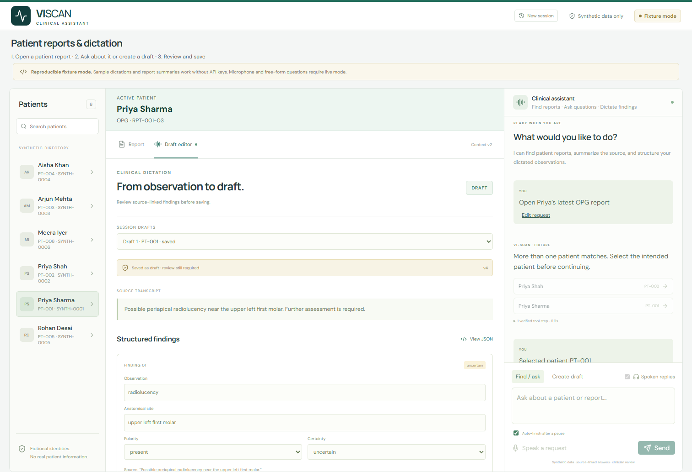

# Demo evidence and walkthrough

The assignment permits a 3-5 minute video **or a documented API sequence with sample outputs**. This package provides the API sequence, recorded outputs, browser screenshots, and opt-in provider smoke scripts. It does not claim that a video has been recorded.

## Reproduce the API demo

Start the server in fixture mode following the README, then run:

```sh
python -m scripts.demo_api
```

Actual captured output: [api-demo.json](../verification/api-demo.json).

1. `POST /api/sessions` creates an owned cookie session.
2. `POST /api/sessions/{id}/commands` with text `Open Priya's latest OPG report`, a unique `utterance_id`, `context_version=0`, and `intent=auto` returns `kind=candidates` with Priya Sharma/PT-001 and Priya Shah/PT-002. No report is selected.
3. `POST /api/sessions/{id}/selection` with `patient_id=PT-001` and the returned context version opens `RPT-001-03`, dated 19 October 2026, modality OPG.
4. A new command `Summarize her report` uses the returned session context. It returns exact excerpts and report ID/version citations. It does not ask for the patient again.
5. A command with `intent=dictate` and the displayed possible-periapical-radiolucency sample produces an editable draft with `certainty=uncertain`, source evidence, computed offsets, and `requires_clinician_review=true`.
6. An attempted `PATCH /api/drafts/{id}` adding an unsupported fracture returns HTTP 422. `POST /api/drafts/{id}/save` for the original valid draft returns `status=saved_draft`; the review flag remains true.
7. `Open Meera Iyer's latest OPG report` returns `kind=missing_report` and clears the active report because that synthetic patient has IOPA/CBCT reports but no OPG.

For each subsequent command, use `session.context_version` from the latest response. Duplicate utterance IDs replay the stored result instead of creating a second draft. API docs at `/docs` expose all request schemas.

## Browser evidence

The images below are preserved historical smoke snapshots, not a claim that every screenshot matches the latest UI. Recent conversation/source-scope checks are linked after them.




[Browser test result](../verification/browser-smoke.json). The repeatable script is `node scripts/browser_smoke.cjs` after installing its browser; see README.

## Recent conversational browser evidence

- [Name recovery with controlled transcripts](../verification/name-recovery-audit.json): no upstream STT connection; speech blocked.
- [All-report scope](../verification/all-reports-browser.json): live text inference, per-report citations, unchanged selected report and speech blocked.
- [Named/repeated follow-ups](../verification/named-followups-browser.json): exact Rohan exchange, current-source evidence and speech blocked.
- [Natural clarification, build and cache/history](../verification/clarification-cache-browser.json): live text interpretation, corrected OPG/CBCT requests, fresh turn IDs and speech blocked.
- [Compound acknowledgements](../verification/acknowledgements-browser.json): local replies; no speech requests.

The latest local unit/API suite has 283 passing tests. Mixed thanks-plus-summary handoff is covered by local integration tests; it was not reclassified as a live voice test.

## Historical live provider evidence

These executions are preserved measurements, not a current model-access/quota guarantee. Later speech quota failures are recorded in F14 of the failure log.

- [Live application workflow](../verification/app-live-smoke.json): actual routing, disambiguation, grounded answer, uncertain draft, unsupported question abstention and TTS.
- [Live voice path](../verification/app-live-voice.json): actual WebSocket partial/final transcript events and file fallback adapter output from synthetic audio.
- [Browser live voice](../verification/browser-live-voice.json): a synthetic Chrome microphone reached the live pipeline and TTS decoded inside the browser.
- [Container smoke](../verification/container-smoke.json): startup/migrations, retrieval and audio asset checks.
- [Model experiments](../verification/model-selection.md): comparisons, raw result links, corrections and limitations.

These tests used synthetic text/audio and the candidate's own configured keys. No secrets are included. Live requests may consume account quota or incur charges depending on the plan.

## Four-minute recording and complete rehearsal

Use [the timed word-for-word script](FOUR-MINUTE-DEMO.md) for the recording and [the complete manual rehearsal scenario](FINAL-REHEARSAL.md) for preparation. The recording prioritizes retrieval/clarification, contextual evidence, editable dictation, source validation, persistence, failure behavior and architecture. Extra name-recovery, all-report and negation/correction cases are in the longer rehearsal.

These documents are a plan for the candidate's device testing/recording, not a claim that a human video has been recorded. Rehearse with speech muted, then reserve real STT/TTS allowance for the device check and recording. Provider delays may require trimming narration or staying within the permitted 3–5 minute window.

Updated UI verification includes readable preview, direct JSON edits, session recovery and a new-session reset. Automatic voice end detection submitted one command in `verification/browser-auto-voice.json`. Full Compose named-volume recovery is recorded in `verification/compose-persistence.json`. Follow `UI-TESTING-GUIDE.md` for the manual rehearsal.
