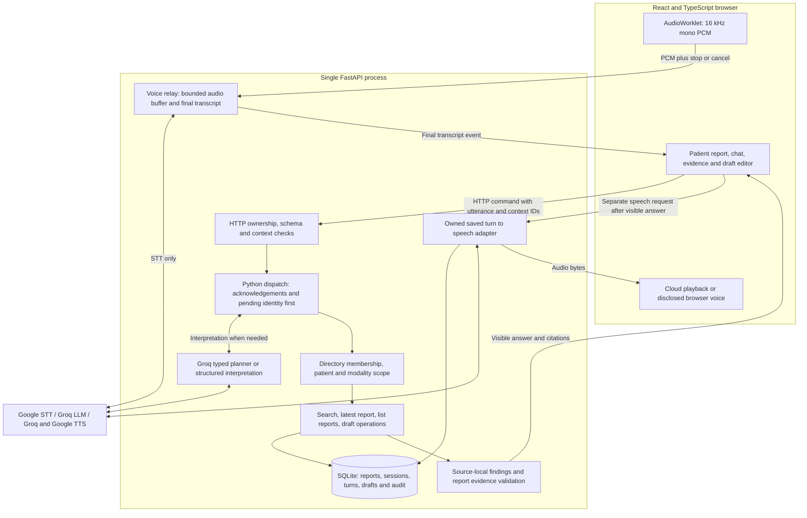
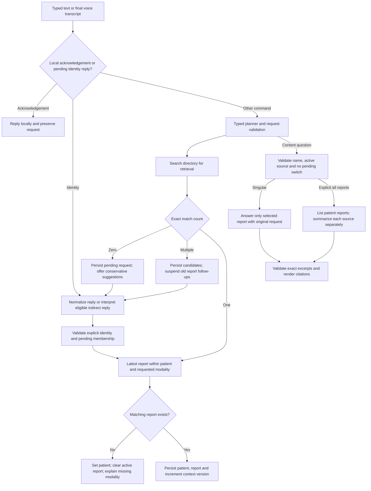
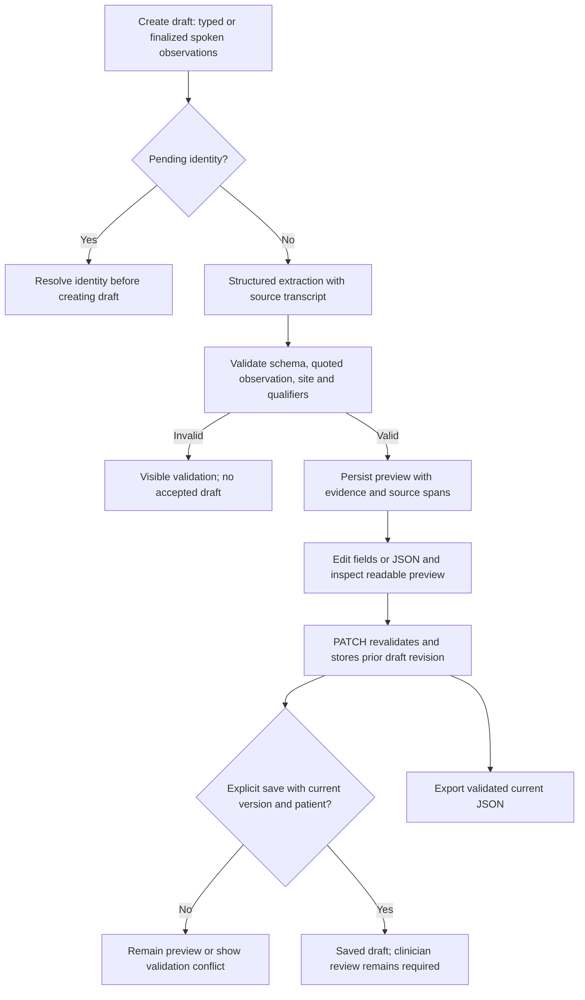
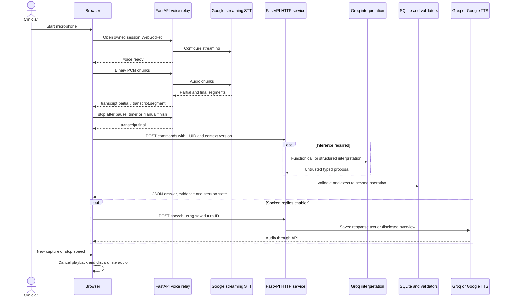
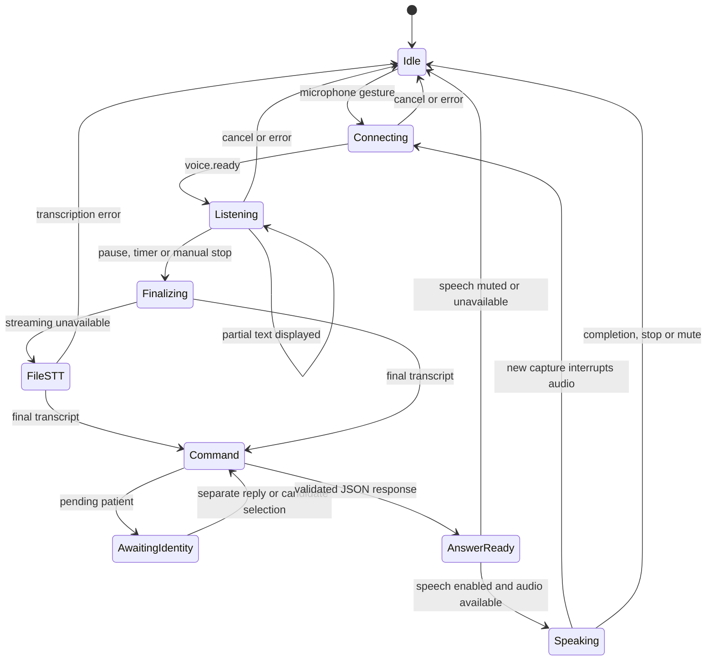
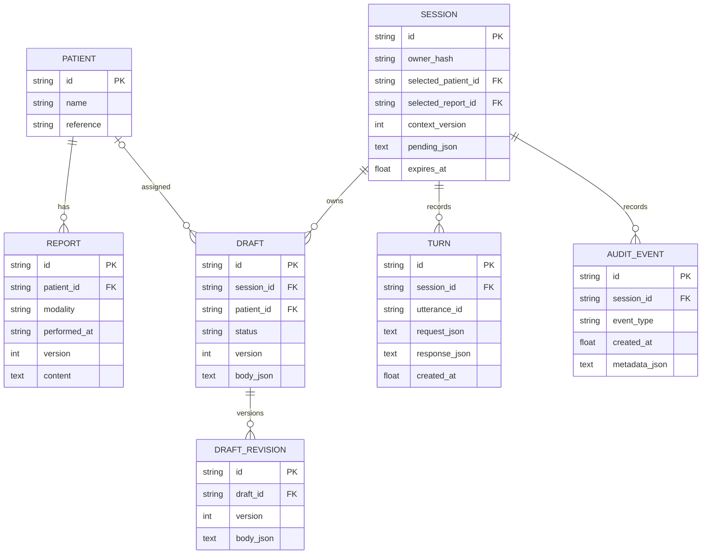

# VI-SCAN voice-first dental assistant: implemented design

Updated 23 October 2026. This document describes the current local implementation. Earlier proposals are superseded where they differ. Read [verification status](implementation-status.md), [workflow audit](WORKFLOW-AUDIT.md) and [failure history](FAILURE-AND-FIX-LOG.md) together; implementation is not proof of universal conversational or clinical correctness.

## 1. Scope and stack

The application retrieves synthetic patient reports, answers source-backed questions, summarizes one or all reports for a resolved patient, and turns dictated observations into editable drafts requiring clinician review. Six fictional patients have 18 revision-2 reports with seven sections each. Meera has no OPG, intentionally exercising missing-modality handling. No imaging inference, clinical signing, booking or production deployment is included.

React/TypeScript/Vite provides a static browser app served by one FastAPI process. Pydantic validates inputs/structured outputs; SQLAlchemy/Alembic stores SQLite data. React hooks and a small fetch client are sufficient for this workspace. PostgreSQL, distributed locking and production identity are future changes, not installed dependencies. No reviewer GPU is required.

The backend modules are `main.py` (HTTP/WS boundaries), `service.py` (state and business operations), `providers.py` (vendor adapters and interpretation), `answers.py` (source-based rendering), `schemas.py`, `voice.py` and `db.py`. There is no LangChain/LangGraph dependency, ReAct loop, vector database or multi-agent runtime.

## 2. Actual architecture

The one-page PDF combines the logical component view with numbered retrieval, dictation-to-draft and contextual follow-up paths. All STT/LLM/TTS edges explicitly traverse provider adapters; database access uses SQLAlchemy separately. The dictation sequence shows transcript → extraction → validate_findings → editable JSON → clinician review → versioned save. This is an explanation of actual execution, not only an inventory of technologies.

The browser commits the final stopped transcript through HTTP. The voice WebSocket does not call the planner or execute clinical actions. Provider credentials remain server-side. Reports/transcripts are untrusted data and cannot authorize another patient or arbitrary SQL.

## 3. Interpretation versus business validation

The actual model-facing function is `plan_assistant_action`, with `action`, `patient_name` and `modality`. Allowed actions are retrieve, summarize, summarize_all, question, dictate and clarify. The adapter validates the function name, argument keys and enum values. Name tokens not present in the current message are removed; retrieval proposals without explicit opening intent are normalized to questions. Repeating a patient name or saying show findings is not automatically a report-open action.

Python then executes allowlisted service operations. Trace entries such as search_patients, get_latest_report, list_patient_reports, resolve_pending_patient, summarize_report, answer_from_report and extract_findings describe operations actually run. They are not separate model-exposed tools or a free-running tool loop.

Pure supported acknowledgements are recognized from the entire message and handled locally. Okay thanks does not call the LLM. Thanks followed by a real question does not match this branch; the full original message reaches interpretation. No thanks retains its identity-decline meaning.

Direct pending name/ID/ordinal replies are resolved locally. Eligible less direct named replies may use a separate structured choose/unresolved interpreter; Python still requires an explicitly present name that uniquely matches pending directory choices. This is an interpretation aid, never permission to invent a patient ID or silently select an approximate match.

## 4. Retrieval, corrections and contextual questions

Approximate first-name/surname or consonant-key matches only propose confirmation. Multiple Priyas never resolve by similarity alone. No-match state accepts a corrected exact full directory name or ID and retains the original modality. A polite closing does not clear the request.

A named question can use the selected report when a unique full name, first name or surname identifies that selected patient. Ambiguous, different or unknown identities require clarification. A different modality question must not be answered using the wrong selected modality. Pending identity suspends old-patient follow-ups even if the previous report remains stored.

Single-report summaries use a principal finding plus a source caveat when supported. The original question is preserved, including cause requests. Citations store exact report ID/version, quote and zero-based/end-exclusive offsets. Python uses controlled source-based formatting rather than displaying model-authored narrative. Unsupported diagnoses abstain; an uncertain finding cannot be inferred to be its own cause. These lexical/source checks are conservative, not a semantic entailment proof.

An explicit collection summary queries only the resolved session patient, optionally filters the requested modality, and orders by date then ID descending. At most three per-report text-model calls run concurrently. Each report has separate metadata/citations. Missing collections and partial generation/validation failures are explicit, with failed IDs and complete=false; they do not masquerade as complete summaries. The selected report is unchanged. Collection results are not an inferred disease-progression comparison.

## 5. Dictation, JSON editing and saving

The actual public Finding schema contains observation, anatomical_site (a string or unspecified), polarity (present/negated/unspecified), certainty (asserted/uncertain/not_definite) and a verbatim evidence string. Python adds source_span and review_flags. Draft body JSON also stores source_transcript, corrections, readable_report and requires_clinician_review=true. Inspect `/docs` or `schemas.py` for exact constraints; a nested tooth-anatomy object is not the implemented contract.

Validation rejects unsupported quoted observations, invented negation, removed uncertainty/no-definite qualifiers, incomplete phrases and certain conflicting sites. Anatomy must occur within the finding evidence or an immediately preceding standalone anatomical fragment, including explicit corrections. The original transcript and superseded correction text remain recorded. These checks do not establish universal clinical fidelity.

A preview may be unbound when no patient is selected, but an unresolved identity switch blocks creation and a save requires a selected patient. A draft already assigned to another patient cannot be saved under the current one. Version checks reject stale edits/saves. PATCH and export return a preview; perform export before the final save when demonstrating saved status. Saving never signs a report or overwrites a source report.

## 6. Actual voice sequence and state

Browser capture uses 16-kHz mono PCM, local energy-based silence detection (~1.6 seconds after detected speech), a ~19-second client timer and a 20-second server limit (640000 PCM bytes). It supports manual stop/cancel and microphone refusal/slow-connection errors. The relay rejects silence, buffers one utterance transiently and tries Groq file STT once if needed. Provider segments are displayed but are not individual clinical commands.

WebSocket events carry transcript/status information, not universal turn/context envelopes. HTTP carries utterance/context IDs. New microphone capture stops HTML/Web Audio/browser-speech playback and invalidates late audio. It does not durably cancel an already executing LLM call or roll back a completed save. This is turn-based voice interaction, not always-on full-duplex listening.

Spoken replies default on for typed, directory and voice actions and reset on reload. Text arrives before a separate speech request. Short replies replay with Listen; long collection summaries explicitly use Listen to overview and point to full on-screen findings. The cloud adapter limits speech input to 600 characters; it is not unrestricted full report reading. Groq TTS falls back to Google; if cloud speech fails and native voices exist, the browser reads the same response/overview with a visible fallback label. Native voice availability and actual audibility require device testing.

## 7. Persistence and authorization boundary

Cookie-owner hashes protect session/draft operations in the demo; this is not login or clinic authorization. Sessions expire after 24 hours. The browser keeps the session ID and matching-version editor state in sessionStorage; database history restores chat, pending selection and drafts in the same tab/session. New session clears the workspace without deleting old stored sessions.

Recent LLM reference context is limited to six completed turns, 1000 characters per message, filtered to the selected patient/report/revision. It is reference context, not clinical evidence. Saved old messages retain original responses and quotations after fixes; reload does not regenerate them. New command UUIDs create new turns; reusing one UUID intentionally replays its stored result. An interrupted pending turn may require a new ID after refreshing state.

SQLite uses foreign keys, busy timeout and WAL with short transactions. Unique session/utterance and draft/revision constraints support idempotency/version history. Process-local locks serialize session actions; run one worker. No distributed concurrency, PostgreSQL migration or multi-clinic enforcement is verified.

APIs use no-store; the HTML/worklet revalidate and frontend API fetches disable caching. No service worker is used. The Build label, `/api/config` build_id and X-App-Build response header fingerprint startup source plus frontend entry HTML. Restart after backend changes and reload the browser after frontend changes. A build ID does not rewrite stored history.

## 8. Providers, latency and quota

Configuration keys actually read by `config.py`: AI_MODE, DATABASE_URL, GOOGLE_API_KEY, GROQ_API_KEY, LLM_MODEL, GOOGLE_STT_MODEL, GROQ_STT_MODEL, GROQ_TTS_MODEL, GOOGLE_TTS_MODEL, TTS_VOICE, ALLOWED_ORIGINS and COOKIE_SECURE. APP_PORT is consumed by Compose for host-port mapping, not by the Python settings object. There are no generic LLM_PROVIDER/STT_PROVIDER selector variables.

Configured defaults: Google gemini-3.5-transcribe-live; Groq openai/gpt-oss-120b; Groq whisper-large-v3 file fallback; Groq canopylabs/orpheus-v1-english with troy; Google gemini-3.8-flash-lite-tts fallback. These are recorded configuration/experiment choices, not a current provider-catalog or free-tier guarantee.

The HTTP command deadline is 55 seconds. Provider HTTP timeout is 25 seconds; transport and selected 502/503/504 failures get one bounded retry. Structured output gets at most one repair. HTTP 429 sets an endpoint/model cooldown using Retry-After (default 60 seconds, bounded to one day), with no early retry. Locks/cooldowns are process-local. There is no durable background queue.

Retrieval commonly uses one planner call; exact pending replies and supported acknowledgements use no text model. Indirect clarification may add one structured call. Questions/drafts add structured inference. Collection summaries add one answer call per matching report, with concurrency three. Speech generation and transcription have separate budgets; fallback can use another vendor. Suppressing unnecessary calls and muted rehearsal preserve demo allowance, but nothing guarantees a free full demo.

[Initial experiments](../verification/model-selection.md) measured four synthetic audio clips and three-case extraction/TTS samples, not human accents, clinical accuracy, sustained latency or a current service SLA. Later TTS quota failures remain recorded in F14. Historical successful cloud audio is separate from later text-only/controlled browser verification. No new vendor call is needed to review these documents.

## 9. Reviewer run, verification and remaining work

Follow [README](../README.md) for pinned native/Docker setup. Bootstrap runs migrations and inserts missing fixtures; only exact archived revision-1 fixtures are upgraded, preserving custom edits. Live mode needs two server-side keys and network access; explicit fixture mode supports limited samples/summaries without keys. Free-form questions and microphone/cloud speech require live mode; there is no silent fixture fallback.

The current local result is 283 passing tests in `verification/tests.xml`. See [workflow audit](WORKFLOW-AUDIT.md) for 36 connected scenarios, named-question/clarification/acknowledgement matrices, partial collection failures and exact browser evidence. Tests do not establish every possible conversation. Prior Docker/Compose/native/provider checks are historical executions, not newly rerun after every edit.

Use [the rehearsal](FINAL-REHEARSAL.md) and [four-minute script](FOUR-MINUTE-DEMO.md). A recorded human demo has not been delivered by the agent. The package includes documented API outputs/screenshots as allowed evidence. Candidate upload, final note review and HR submission remain manual actions.

Production work would require real identity/clinic-scoped queries, transport/storage encryption, retention/deletion controls, vendor privacy review, monitoring, multi-worker data/lock design and broader clinical and human-voice evaluations. Keys stay server-side, audio buffers are transient, and local transcripts/history persist. This POC is not regulatory certification or a medical diagnostic system.
